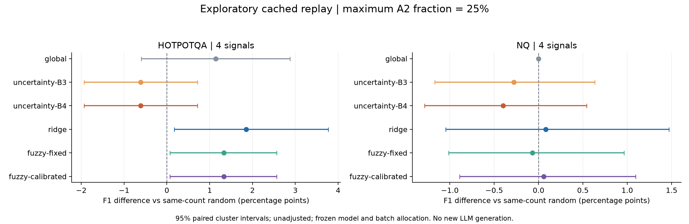
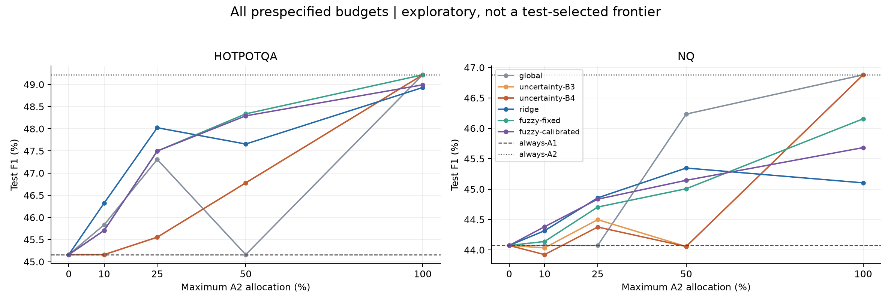

# experiment_ver2：實際結果與研究判讀

日期：2026-10-16。資料來自 main `667639a` 的已保存模型輸出；本次執行的是完整 cached-outcome 重評，**沒有重新呼叫 LLM 或重新收集 latency**。

## 結論

以 A1 為基準、直接預測 A2 額外效益，比單純以不確定度排序更值得研究。主配額 25% 下，HotpotQA 的 fuzzy 與 ridge 都有正向探索結果；NQ 無法明確區分於同次數隨機分配。**沒有證據支持 fuzzy 勝過 ridge，亦未建立寬度校準的獨立貢獻。**

舊方法在低成本 rerank 下退化成 always-A1，是成本結構與效益預測問題。本版完成可重現的改進與檢驗，但不能把這些結果稱為原假說成功，或保證論文貢獻已成立。

## 資料與重現

| 資料集 | TRAIN instances | VAL instances | 舊 TEST instances | v0.4 fresh instances | fresh clusters／完整 clusters |
|---|---:|---:|---:|---:|---:|
| NQ | 506 | 165 | 170 | 412 | 150／128 |
| HotpotQA | 531 | 179 | 176 | 443 | 150／143 |

原 v0.4 的 NQ、HotpotQA、pooled 報告共 **6,494 個數值逐一完全相同，最大誤差 0**；資料完整性檢查涵蓋 5,164 筆 A1／A2 outcomes，答案 EM／F1 重算一致，沒有重複 action keys。latency 各分量和與總值最大差約 `1.78e-15`。32 個來源 JSON／JSONL 檔案執行前後 SHA256 未改變。[驗證紀錄](validation/reproduction.json)

舊／fresh 的 cluster IDs、source indices、正規化原題文字重疊均為零；這不等於已人工驗證沒有語意重複。fresh 結果在此次分析前已公開與被檢視，因此本版仍標**探索性**。缺少 paraphrase 的 cluster 留在品質評估，只有完整 cluster 進入 RFR／HRFR。

v0.3 未提交 raw training signals，因此本次沿用封存的 training scaler／scaled signals，不能獨立驗證最初 scaler 的擬合來源。TRAIN jitter 已重新計算並與保存紀錄核對一致；fresh raw signals 使用同一個 frozen scaler。模型只用 TRAIN outcomes，超參數與回退策略只用 VAL。

## 事前固定於本輪分析的設定

主方法使用 S1–S4、81 條 product fuzzy rules，rule action means 向 TRAIN global mean 收縮；每個 cluster 訓練總權重為 1。固定／校準 widths 分開報告，pseudo-count `[1,5,20]`；ridge alpha `[0.1,1,10]`。保留所有配額 `[0,.10,.25,.50,1]`，主配額 `.25`。這些設定在取得新版 cache 前即已寫入程式，並非從以下 test 結果挑選。

v0.4 只有 A1／A2，沒有人工補造 A0。每批最多 `floor(q*n)` 筆升級 A2；效益模型只升級預測 ΔF1>0 的查詢，VAL 可選擇整體退回 always-A1。這是 batch quota，不是線上 router 或 latency 預算保證。

## 主結果：v0.4 fresh、四訊號、最大 A2 比率 25%

F1 採 0–1；cost 為舊 cache 的平均秒數，不含新路由器線上實測 overhead。固定 always-A2 不受 25% 上限，僅為參考。

| 方法 | NQ F1 | NQ cost | HotpotQA F1 | HotpotQA cost |
|---|---:|---:|---:|---:|
| always-A1 | 0.4407 | 5.661 | 0.4516 | 4.291 |
| always-A2（100%） | 0.4688 | 11.916 | 0.4922 | 9.023 |
| 原 uncertainty-B3（配額版） | 0.4450 | 7.227 | 0.4555 | 5.467 |
| 原 uncertainty-B4（配額版） | 0.4438 | 7.229 | 0.4555 | 5.469 |
| ridge utility | 0.4486 | 7.241 | 0.4802 | 5.479 |
| fuzzy fixed | 0.4470 | 7.228 | 0.4750 | 5.452 |
| fuzzy calibrated | 0.4483 | 7.225 | 0.4750 | 5.452 |

上述非固定方法的 A2 次數為 NQ 103／412、HotpotQA 110／443。global 訊號無關策略另外保留在完整結果中，不取代解析的隨機參考。

校準 fuzzy 的 paired ΔF1 與 95% cluster-bootstrap CI（**未作多重比較校正**）：

| 比較對手 | NQ ΔF1 [95% CI] | HotpotQA ΔF1 [95% CI] |
|---|---|---|
| always-A1 | +0.0076 [−0.0031, +0.0194] | +0.0234 [+0.0105, +0.0390] |
| 相同 A2 次數的隨機分配期望 | +0.0006 [−0.0089, +0.0109] | +0.0133 [+0.0008, +0.0257] |
| ridge utility | −0.0002 [−0.0151, +0.0127] | −0.0053 [−0.0240, +0.0116] |
| fuzzy fixed | +0.0013 [0.0000, +0.0034] | 0.0000 [0.0000, 0.0000] |

HotpotQA 相對隨機策略的 interval 僅小幅排除零，且有多個資料集／方法／配額比較，不能當作確認性顯著結論。ridge 的 HotpotQA F1 更高，與 fuzzy 差異 interval 包含零。NQ 的 routing 受益不明確；不能只留下 HotpotQA 正向結果。

## 消融與歷史資料

同樣 q=.25 下，S2–S4 三訊號 fuzzy calibrated：NQ F1 `0.4443`，相對同次數隨機 ΔF1 `−0.0034 [−0.0116,+0.0055]`；HotpotQA F1 `0.4663`，ΔF1 `+0.0047 [−0.0088,+0.0182]`。本次沒有證據顯示刪除 S1 優於保留四訊號。此消融不更換主方法。

v0.3 舊 test 與 v0.4 舊 test 也已完整執行並保存；它們不是獨立的新確認性資料。所有 budgets 均公開，不從曲線挑最佳 test 點當作 headline。新 budget 的 test 表現不必單調，VAL 選擇的候選或 always-A1 回退可能改變。

| 分析 | 完整摘要 |
|---|---|
| v0.4 fresh 四訊號主分析 | [報告](evidence/v04_fresh_4sig/REPORT.md) |
| v0.4 fresh 三訊號消融 | [報告](evidence/v04_fresh_3sig/REPORT.md) |
| v0.4 舊 test | [報告](evidence/v04_old/REPORT.md) |
| v0.3 舊 test | [報告](evidence/v03_old/REPORT.md) |

每組另附 model parameters、逐題 decisions／scores／主配額 rule traces、所有配額詳細 metrics、input/source hashes。主比較沒有重新跑 generation；較低 cached cost 不能轉述為已實測的新系統加速。

## 原 v0.4 評估的限制

原數值可再現，但原 `scripts/evaluate_v4.py` 的 strongest baseline 由 test F1 選取，mixture 亦以 test cost 配出，且部分 success flags 只是點估計比較。本版改為 VAL 選 baseline，主隨機對手由 frozen actions 的 A2 次數決定混合比例。

原 HotpotQA B4 fresh latency `6.7583s` 超過 validation budget `6.4775s`，約 4.34%；validation 守住平均成本不代表 test 保證守住。本版使用可直接檢查的呼叫配額，並另外揭露 measured cost。

原 pilot 的 `passes_bar=false`：選定 V1 相對 A1 pooled gain 約 `0.00119`，低於原門檻 `0.04`。這不會使已收集 outcomes 失效，但後續仍進行完整實驗的決策理由需補原 runlog，不能隱去未過門檻的紀錄。

## 工程驗證與仍需完成的研究工作

完整測試與執行環境記錄見 [VALIDATION.md](VALIDATION.md)。測試涵蓋修改 test labels／cost 不改模型與決策、真實兩動作資料、train-only fit、資料對齊與錯誤拒絕。結果由獨立程式核對 240 個 method×budget×dataset blocks；主要 fuzzy rule weights 與 consequents 可重建記錄的 ΔF1。

仍需人工 paraphrase 語意稽核、raw training signals 的 scaler 來源核對、固定硬體的線上 timing，以及對尚未曝光的原始問題進行事先固定的確認性測試。現有結果支持保留 ridge 為強 baseline、謹慎檢驗 fuzzy 的獨立價值；不以反覆調整已看過的 test 追求成功。
